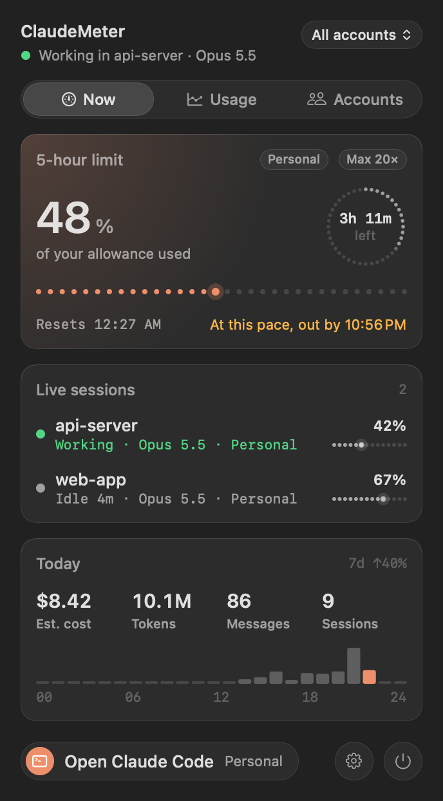
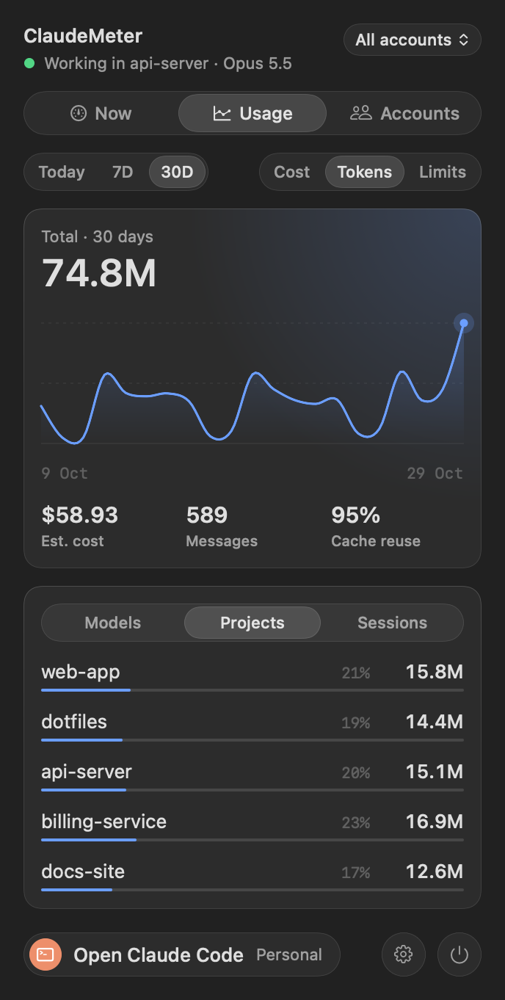
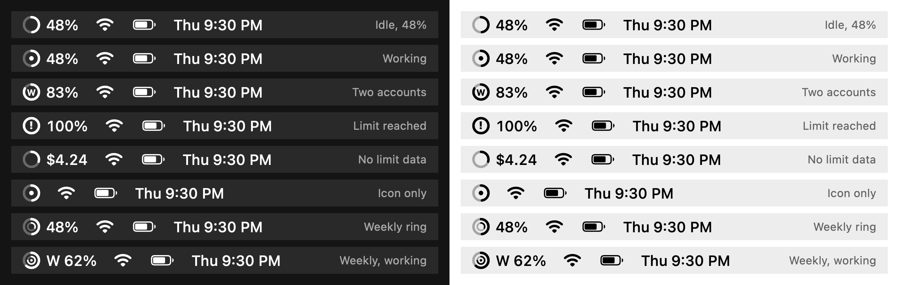
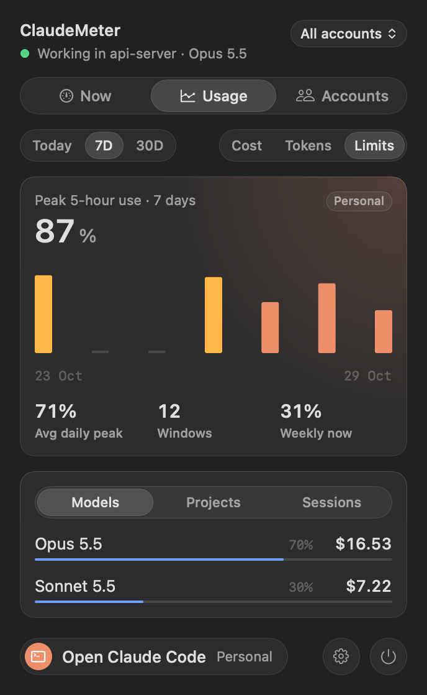
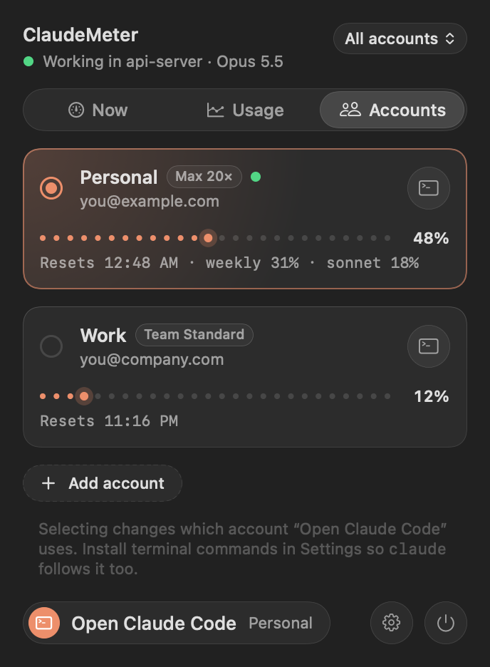

# ClaudeMeter

[](https://github.com/springmusk026/ClaudeMeter/actions/workflows/build.yml)
[](https://github.com/springmusk026/ClaudeMeter/releases/latest)
[](LICENSE)

A native macOS menu bar app that shows your **Claude Code** usage at a glance: how much of your plan limit is left, what's running right now, and where your tokens go.

It only reads files on your Mac. No network requests, no logins, no API keys.

<p align="center">
  
  
</p>

<p align="center">
  
</p>

## Features

- **Plan limits**: your real 5-hour, weekly and per-model weekly (e.g. Sonnet only) usage and reset times, as reported by Claude Code. Kept fresh even with no session open.
- **Forecast**: "At this pace, out by 10:56 PM", from your pace over the last hour.
- **Limit history**: your peak 5-hour usage per hour or day over 30 days, how many windows you used and how often you hit the limit.
- **Menu bar meter**: a ring that fills with your 5-hour usage, with an inner ring for the weekly limit. A dot means Claude is working; **!** means a limit is reached.
- **Live sessions**: every open Claude Code session, whether it's working or idle, and how full its context window is (with a nudge to `/compact` near the end).
- **Usage history**: cost or tokens for today, 7 or 30 days, broken down by model, project and session. Costs are estimated at Anthropic API list prices.
- **Multiple accounts**: see each account's limits side by side and choose which one new `claude` sessions use. Accounts stay fully separate; ClaudeMeter never touches login credentials.
- **Alerts**: notifications at your warning and critical levels (80% and 95% by default) for every limit, when a 5-hour window resets, and for an optional daily budget.
- **Status line**: a matching Claude Code status line with model, context, limits and cost.
- **JSON output** for scripts, Raycast or SketchyBar: `ClaudeMeter --json`.
- **Copy Diagnostics** in Settings for bug reports, with no emails, account or project names.
- Follows the system light/dark appearance and respects Reduce Motion.

<p align="center">
  
  
</p>

## Requirements

- macOS 14 Sonoma or later
- [Claude Code](https://claude.com/claude-code)
- `jq` for the status line (`brew install jq`)
- To build from source: Xcode or the Xcode Command Line Tools (Swift 5.9+)

## Install

### Download

1. Download `ClaudeMeter.zip` from the [latest release](https://github.com/springmusk026/ClaudeMeter/releases/latest), unzip it, and move **ClaudeMeter.app** to Applications.
2. The app isn't notarized by Apple, so the first launch is blocked. Right-click the app, choose **Open**, then **Open** again. Or run:
   ```sh
   xattr -dr com.apple.quarantine /Applications/ClaudeMeter.app
   ```
3. For plan limits and live sessions, install the status line from a clone of this repo (`./scripts/install-statusline.sh`).

### Build from source

```sh
git clone https://github.com/springmusk026/ClaudeMeter.git
cd ClaudeMeter
./build.sh                       # builds, installs to ~/Applications and launches
./scripts/install-statusline.sh  # optional, enables plan limits and live sessions
```

Then open **Settings… (⌘,)** from the panel and turn on **Launch at login**.

Plan limits and live session data come from Claude Code's status line, so they appear after you install the status line and start (or restart) a Claude Code session. Without it, ClaudeMeter still shows usage and cost from the logs, with an estimated 5-hour window.

## How it works

| Data | Source |
|---|---|
| Tokens, cost, sessions, history | Claude Code's local logs in `~/.claude/projects/*.jsonl`, read incrementally |
| Plan limits, context fill, live sessions | Claude Code passes these to its status line; `statusline.sh` saves them to `~/.claude/claudemeter/live/` |
| Fresh and per-model limits | Every 5 minutes, and when you open the panel, the app runs `claude -p /usage --no-session-persistence` for each signed-in account. It's a local command: no model request, no cost, no session record. Turn it off in Settings › Limits. |
| Limit history | Readings saved to `~/Library/Application Support/ClaudeMeter/history/` (30 days) |
| Signed-in email and plan | The account profile in `~/.claude.json` (no tokens) |

The app watches those folders and updates within a second of Claude writing to them. It writes a small summary to `~/.claude/claudemeter.json` so the status line can show daily totals.

**Is this allowed?** ClaudeMeter only reads files Claude Code already writes on your machine and data Claude Code hands to status line scripts. It doesn't call Anthropic's servers, reuse your login, or scrape claude.ai.

### Multiple accounts

Each extra account gets its own Claude Code config folder (`~/.claude-<name>`), using Claude Code's `CLAUDE_CONFIG_DIR` setting, so each keeps its own login. Add accounts in **Settings › Accounts**, then click **Sign In** and run `/login` in the Terminal window that opens.

With **Terminal commands** installed (Settings › Accounts), plain `claude` starts whichever account is selected in the panel, and `claude-<name>` starts a specific one. Switching is always manual.

Please follow Anthropic's terms for your plan. Never share an account with another person.

## Development

```
Sources/
  App.swift            app entry, menu bar icon
  PanelView.swift      the panel: Now, Usage and Accounts tabs
  Design.swift         design system: tokens and components
  Theme.swift          spacing and semantic colors
  Format.swift         number and time formatting
  SettingsView.swift   settings window
  Store.swift          state, refresh, notifications, status line summary
  Stats.swift          usage summaries, 5-hour windows, forecasts
  LogReader.swift      incremental JSONL reader and folder watcher
  LiveData.swift       live data saved by the status line
  Accounts.swift       accounts, profiles, launching, shell commands
  Probe.swift          runs and parses `claude /usage`
  History.swift        saved limit readings and recent pace
  Export.swift         --json output and diagnostics
  Model.swift          pricing, records, formatting
  Snapshot.swift       render the UI to PNG for review
  Demo.swift           made-up data for screenshots
scripts/
  statusline.sh        the Claude Code status line
  install-statusline.sh
tools/make-icon.swift  renders the app icon
```

There's no Xcode project: `./build.sh` compiles `Sources/*.swift` with `swiftc` and assembles the app bundle.

**Usage as JSON**, e.g. for a script or another menu bar tool:

```sh
~/Applications/ClaudeMeter.app/Contents/MacOS/ClaudeMeter --json             # asks Claude Code for fresh limits first
~/Applications/ClaudeMeter.app/Contents/MacOS/ClaudeMeter --json --no-probe  # logs and saved data only, instant
```

**Look at your changes.** Render every tab (light and dark), the Limits view and every menu bar icon state to PNG:

```sh
build/ClaudeMeter.app/Contents/MacOS/ClaudeMeter --snapshot /tmp/shots          # your real data
build/ClaudeMeter.app/Contents/MacOS/ClaudeMeter --snapshot /tmp/shots --demo   # made-up data
```

The README screenshots are made with `--demo`. See [CONTRIBUTING.md](CONTRIBUTING.md) for design rules and the change checklist.

## Disclaimer

ClaudeMeter is an independent project and is not affiliated with or endorsed by Anthropic. Claude and Claude Code are trademarks of Anthropic. Cost figures are estimates; subscription plans are not billed per token.

## License

[MIT](LICENSE)
